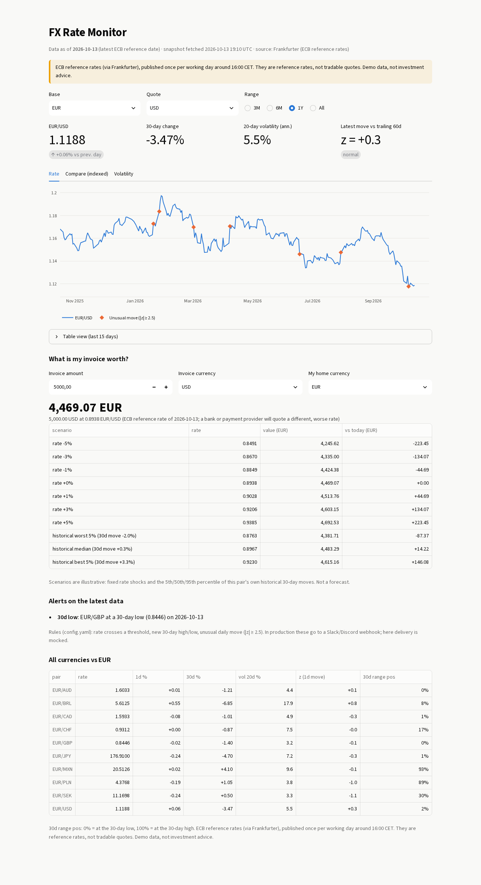
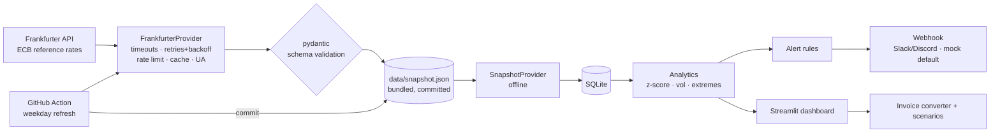

# FX Rate Monitor & Alerts

> **For an exporter or freelancer paid in a foreign currency:** know what an invoice is worth *today*, see how much that can swing, and get pinged when a rate crosses a level or makes an unusual move.

**Live demo:** _(Streamlit Community Cloud URL: to be added)_ · Reference/demo data, **not investment advice, no trading features.**



Light, dark and mobile layouts: [dark](docs/dashboard-dark.png) · [mobile](docs/dashboard-mobile.png).

## What it does
- **Daily ECB reference rates** for a configurable currency list (`config.yaml`), stored in **SQLite** history.
- **Alerts:** rate crosses a threshold, new N-day high/low, **unusual daily move** (z-score of the day's % change vs the previous 60 days, no look-ahead). Delivered to a Slack/Discord-compatible webhook: **mocked by default** (prints), real URL only via `ALERT_WEBHOOK_URL`. Each alert is sent once (dedupe key per rule per day).
- **Rolling volatility** (20-day, annualised) and a movers table for every currency.
- **"What is my invoice worth?"**: converter with a scenario table (±1/3/5% rate shocks, plus the 5th/50th/95th percentile of that pair's own historical 30-day moves). Descriptive, not a forecast.
- **Scheduled refresh:** a GitHub Action fetches new rates each weekday and commits the small `data/snapshot.json`.



## Offline by design
Tests, CI and the Streamlit demo read the **bundled snapshot** (`data/snapshot.json`, 281 days × 10 currencies, real ECB reference data with its fetch timestamp shown in the UI), so the app never shows a blank page and never calls the network at runtime. Live data only enters through the scheduled refresh workflow.

## Run it
```bash
pip install -r requirements.txt
streamlit run streamlit_app.py        # dashboard (offline)
python -m fxmon check                 # evaluate alerts on the snapshot (mock webhook)
python -m fxmon refresh               # live: fetch new rates, merge into the snapshot, evaluate alerts
pip install -r requirements-dev.txt && pytest -q
```
Real alerts: set `ALERT_WEBHOOK_URL` (and `ALERT_WEBHOOK_KIND=slack|discord`) as an environment variable / GitHub secret. Never commit it.

**Streamlit Community Cloud:** repo `alfiochoa/fx-rate-monitor`, branch `main`, main file `streamlit_app.py`.

## Data sources & terms
- **[Frankfurter](https://frankfurter.dev)**: open-source API serving ECB reference rates; free, no API key. Endpoint used: `/v1/{start}..{end}`.
- **European Central Bank** euro foreign exchange reference rates: published around 16:00 CET on working days. ECB statistics may be reused free of charge provided the source is acknowledged ([ECB copyright notice](https://www.ecb.europa.eu/services/disclaimer/html/index.en.html)). Check current terms before commercial redistribution.
- The client identifies itself with a `fx-rate-monitor/…` User-Agent, rate-limits and caches requests.

## Engineering notes
Provider/adapter architecture (`Provider` protocol: live Frankfurter or bundled snapshot) · retries with exponential backoff, timeouts, min request interval, on-disk cache · pydantic validation of API payloads and snapshot · JSON structured logs · 17 pytest tests (fakes, fixtures, Streamlit `AppTest`), all offline · CI: ruff + pytest · charts follow a validated colour palette (colour-blind separation checked), identity never by colour alone (legend, direct labels, table view), light/dark.

## Limitations
- **ECB reference rates are not tradable quotes.** Banks/payment providers apply spreads and fees; real conversions will be worse than shown.
- One rate per working day: no intraday data, no weekends/holidays; ~30 currencies max (ECB set).
- Statistics (z-score, volatility, percentile scenarios) describe history; they do **not** predict. Not investment, tax or hedging advice. No trading features.
- Alert evaluation runs on the refresh schedule, not in real time. Webhook delivery is mocked unless you configure a URL.
- Snapshot history is ~13 months; cross rates are computed through the EUR legs (ECB publishes everything vs EUR).
